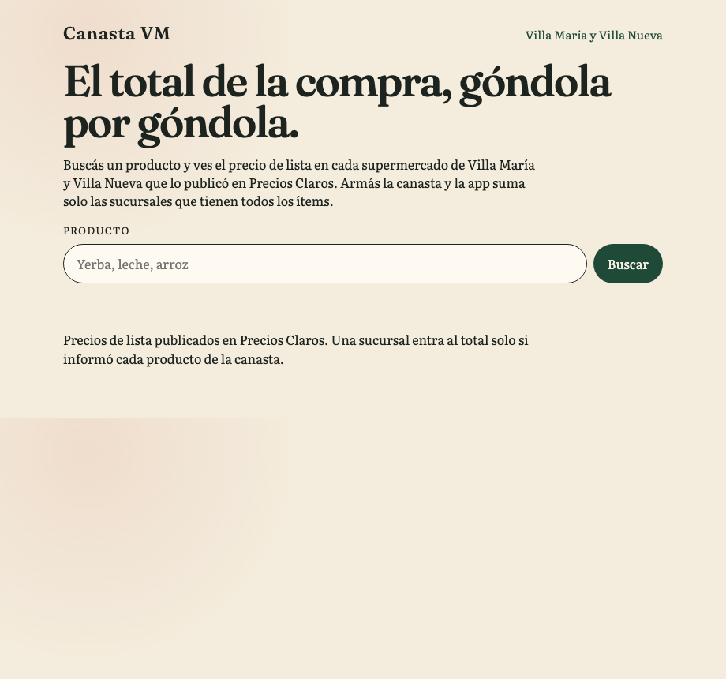
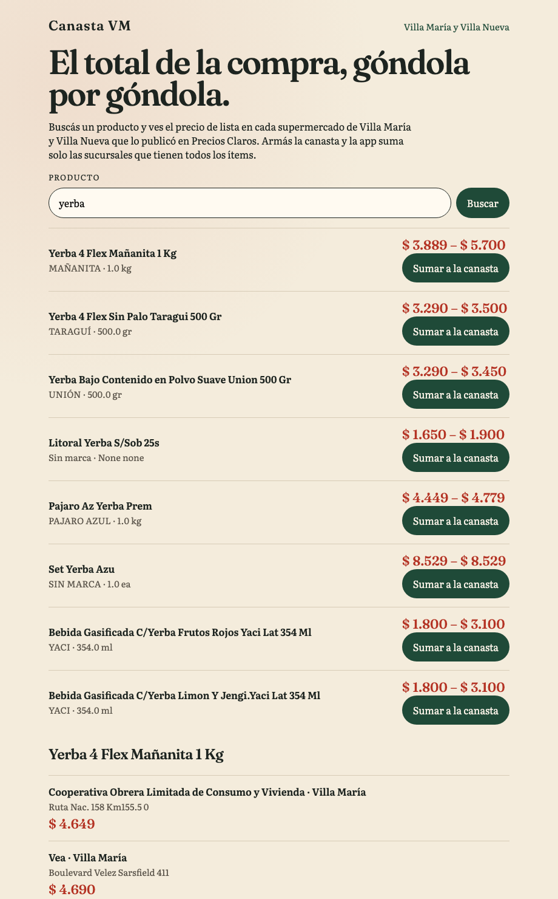
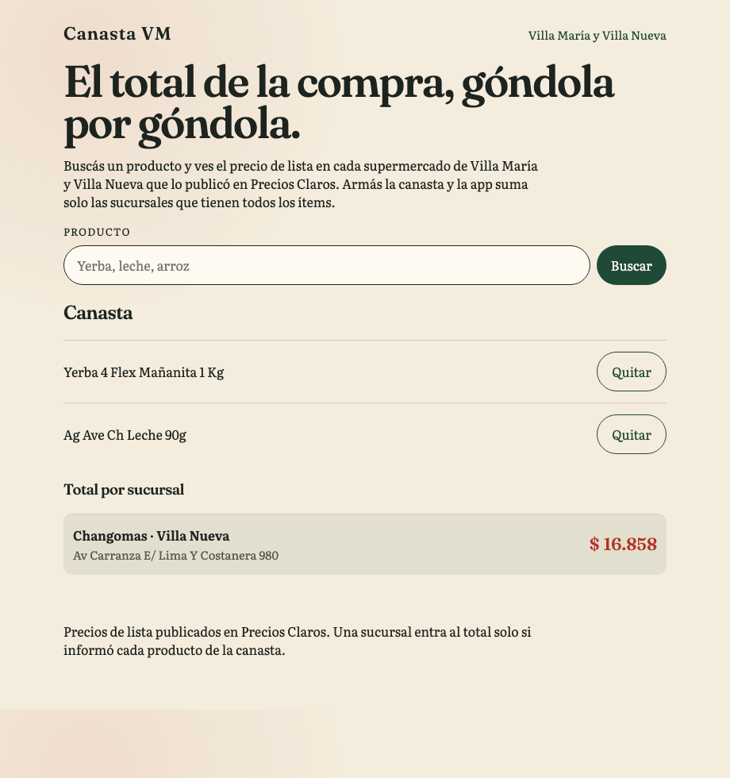

# Canasta VM

El total de la compra, góndola por góndola.

Buscás un producto y ves el precio de lista en cada supermercado de Villa María y Villa Nueva que lo publicó en Precios Claros. Armás la canasta y la app suma solo las sucursales que tienen todos los ítems.



## Búsqueda y sucursales

Cada resultado trae el rango publicado para ese producto. Al sumarlo a la canasta, abajo quedan las sucursales de las dos ciudades, con dirección y precio de lista.



## La canasta

Yerba y leche, el mismo día. Changomas de Villa Nueva fue la única sucursal que había publicado precio para los dos. El total de esa captura fue $ 16.858.



Ese número es el de la captura. Mañana el archivo de Precios Claros cambia y el total también.

## De dónde sale el precio

La pantalla lee la API pública de Precios Claros, que publica los precios de lista del sistema SEPA. El catálogo diario también está en [datos.produccion.gob.ar/dataset/sepa-precios](https://datos.produccion.gob.ar/dataset/sepa-precios), licencia CC-BY-4.0.

Entran sucursales cuya localidad es Villa María o Villa Nueva. Una sucursal sin precio para algún ítem de la canasta no aparece en el total.

## Cómo abrirla

```bash
python3 -m http.server 4173 --directory web
```

Después, http://127.0.0.1:4173/

`?vista=sucursales&q=yerba` abre la búsqueda y las sucursales del primer resultado. `?vista=canasta` arma yerba y leche.

```bash
python -m pytest
```
